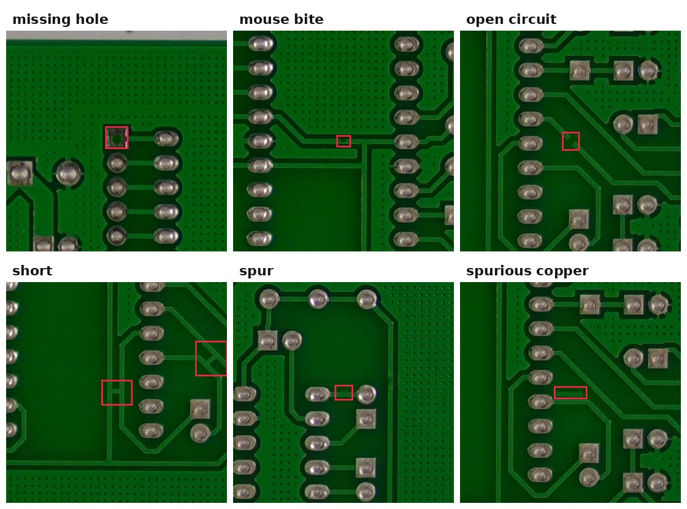
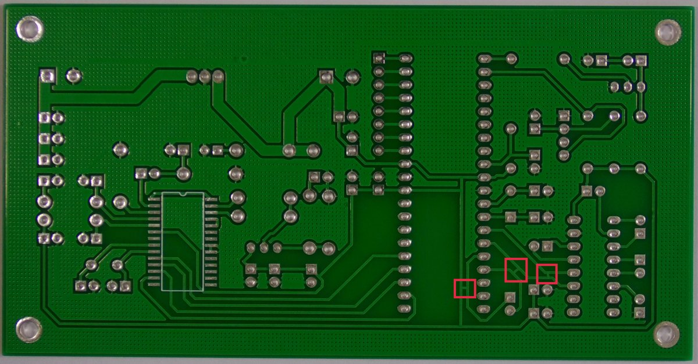
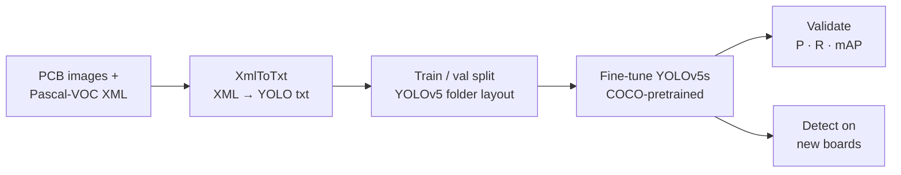

<div align="center">

# 🔍 PCB Defect Detection with YOLOv5

**Automated visual inspection of printed circuit boards — six manufacturing defect types detected and localised in a single pass.**

[](#)
[](#)
[](https://github.com/ultralytics/yolov5)
[](#)
[](LICENSE)

</div>

---

## Overview

Manual PCB inspection is slow and error-prone, and many defects are only a few pixels wide on a full-board image. This project fine-tunes **YOLOv5s** to detect and localise six common PCB defects, and includes the full pipeline from Pascal-VOC XML annotations to a trained detector.

| Defect | Description |
|---|---|
| `missing_hole` | A drilled hole that is absent |
| `mouse_bite` | Small bite-shaped notches along a copper edge |
| `open_circuit` | A break in a copper trace |
| `short` | Unintended copper bridge between two traces |
| `spur` | A thin copper protrusion from a trace |
| `spurious_copper` | Leftover copper where none should be |

<p align="center">
  
  <br><sub>Close-ups of each defect type with its ground-truth bounding box (from the dataset annotations).</sub>
</p>

## Results

YOLOv5s (7.0 M parameters, 15.8 GFLOPs) · 416 px input · 50 epochs · batch 16 · validation set of 138 images / 583 labelled defects.

| Class | Precision | Recall | mAP@0.5 | mAP@0.5:0.95 |
|---|:---:|:---:|:---:|:---:|
| missing_hole | 0.906 | 0.955 | **0.973** | 0.441 |
| short | 0.818 | 0.812 | **0.840** | 0.351 |
| mouse_bite | 0.447 | 0.573 | 0.418 | 0.138 |
| open_circuit | 0.477 | 0.580 | 0.425 | 0.136 |
| spur | 0.441 | 0.538 | 0.425 | 0.152 |
| spurious_copper | 0.448 | 0.485 | 0.370 | 0.146 |
| **All classes** | **0.589** | **0.657** | **0.575** | **0.228** |

<p align="center">
  
  <br><sub>A full board with its three annotated <code>short</code> defects: each one covers well under 1% of the image.</sub>
</p>

**Takeaways.** Large, well-defined defects (missing holes, shorts) are detected reliably. The four thin, small defects score much lower: at 416 px a full PCB image is heavily downscaled, so features that are only a few pixels wide largely disappear. Training at a higher resolution or on image tiles is the most promising next step (see [Roadmap](#roadmap)).

## Pipeline



1. **Annotation conversion** — [`XmlToTxt-master/`](XmlToTxt-master) converts Pascal-VOC bounding boxes into normalised YOLO format using the class list in `classes.txt`.
2. **Dataset layout** — [`scripts/prepare_dataset.py`](scripts/prepare_dataset.py) writes a seeded, class-stratified split into `images/{train,val}` and `labels/{train,val}` (the original exploratory version is in [`notebooks/01_data_preparation.ipynb`](notebooks/01_data_preparation.ipynb)).
3. **Training & evaluation** — [`notebooks/02_training_yolov5_colab.ipynb`](notebooks/02_training_yolov5_colab.ipynb) clones YOLOv5, trains from `yolov5s.pt`, validates, and runs detection.

## Getting started

```bash
git clone https://github.com/ChatushRaj/PCB-Defect-Detection.git
cd PCB-Defect-Detection

# 1. Build the YOLO dataset: converts XML → YOLO labels and makes a
#    reproducible, class-stratified 80/20 split into dataset-pcb/
python scripts/prepare_dataset.py

# 2. Train with YOLOv5
git clone https://github.com/ultralytics/yolov5.git
cd yolov5 && pip install -r requirements.txt
python train.py --img 416 --batch 16 --epochs 50 \
                --data ../notebooks/dataset.yaml --weights yolov5s.pt --cache --name pcb

# 3. Evaluate and detect
python val.py    --weights runs/train/pcb/weights/best.pt --data ../notebooks/dataset.yaml
python detect.py --weights runs/train/pcb/weights/best.pt --source path/to/pcb_image.jpg
```

> The standalone converter in [`XmlToTxt-master/`](XmlToTxt-master) produces identical labels if you prefer it:
> `python xmltotxt.py -c classes.txt -xml ../PCB_DATASET/Annotations -out out`

## Dataset

[PCB Defects dataset](https://www.kaggle.com/datasets/akhatova/pcb-defects) (originally released by the Open Lab on Human-Robot Interaction, Peking University): **693 images** of 10 base boards with synthetically introduced defects and **2,953 annotated defects** across the six classes (~115 images per class).

```
PCB_DATASET/
├── Annotations/<class>/*.xml   Pascal-VOC bounding boxes
├── images/<class>/*.jpg        Defective boards
└── PCB_USED/                   The 10 defect-free reference boards
```

## Project structure

```
PCB-Defect-Detection/
├── notebooks/
│   ├── 01_data_preparation.ipynb       XML → YOLO conversion and train/val split
│   ├── 02_training_yolov5_colab.ipynb  Training, validation and detection (Colab, with outputs)
│   └── dataset.yaml                    YOLOv5 dataset config (6 classes)
├── scripts/prepare_dataset.py          XML → YOLO conversion + reproducible train/val split
├── XmlToTxt-master/                    Pascal-VOC → YOLO converter
├── PCB_DATASET/                        Images and annotations
├── requirements.txt
└── LICENSE
```

## Roadmap

- [ ] Train at higher resolution (640–1024 px) or on tiled crops to recover small defects
- [ ] Compare with YOLOv8 / YOLO11
- [ ] Serve the model through a small FastAPI endpoint
- [ ] Export to ONNX / TensorRT for edge inspection hardware

## Acknowledgements

- [Ultralytics YOLOv5](https://github.com/ultralytics/yolov5)
- [XmlToTxt](https://github.com/isabek/XmlToTxt) by Isabek Tashiev — annotation converter
- PCB defect dataset — Open Lab on Human-Robot Interaction, Peking University

## License

Copyright © 2026 Chatush Raj Thotamsetty. **All rights reserved.**

This code is published for viewing and evaluation only. Third-party parts keep their own terms: the [XmlToTxt](https://github.com/isabek/XmlToTxt) converter in `XmlToTxt-master/` belongs to its author, and the PCB dataset in `PCB_DATASET/` belongs to the Open Lab on Human-Robot Interaction, Peking University. It may not be copied, reused, modified or redistributed, in whole or in part, without written permission. See [LICENSE](LICENSE) for the full terms.
